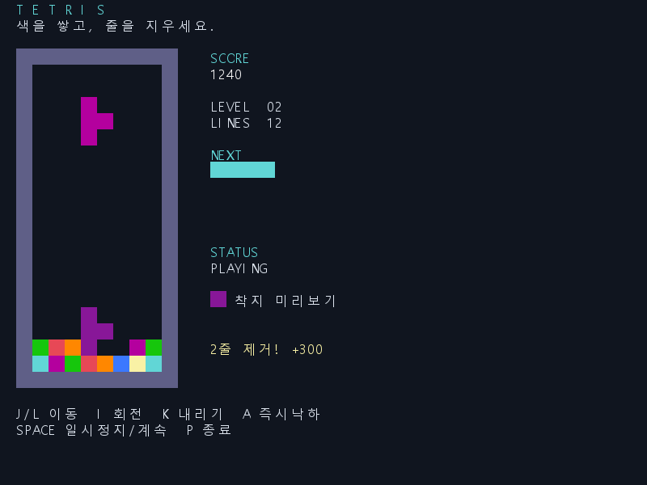

# Tetris

C언어로 구현한 터미널 기반 테트리스입니다.
배열을 이용한 충돌 판정과 동적 배열을 이용한 게임 기록 관리를 구현했습니다.

## 화면 예시



## 실행 방법

WSL 또는 Linux 환경에서 GCC와 Make가 필요합니다.
터미널 크기는 최소 80×30으로 설정해주세요.

```bash
make
./tetris
```

## 조작법

| 키 | 기능 |
|---|---|
| J / L | 좌우 이동 |
| I | 회전 |
| K | 아래로 이동 |
| A | 즉시 낙하 |
| Space | 일시정지 / 계속 |
| P | 게임 종료 |

## 기능

- 보라색 고스트 블록으로 착지 위치 표시
- 7-bag 방식의 블록 생성
- 벽·바닥 근처 회전 보정
- 10줄마다 레벨 및 낙하 속도 증가
- 게임 기록 저장, 이름 검색, 점수순 정렬

게임 기록은 실행한 폴더의 `result.txt`에 저장됩니다.
